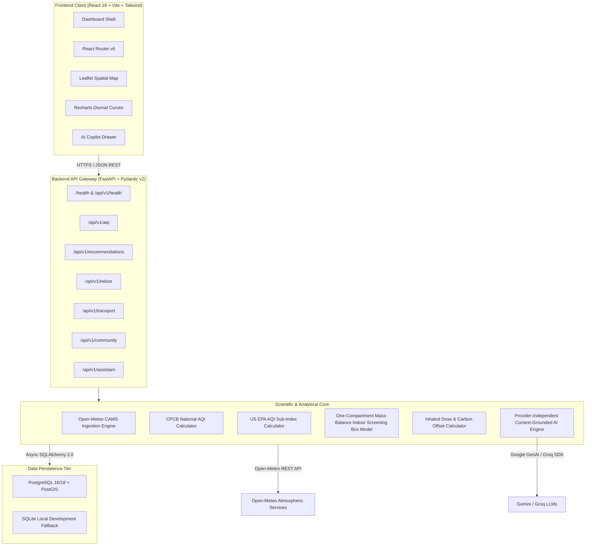

# AirGuard AI — System Architecture & Technical Specifications

**Platform:** AirGuard AI — Urban Air Quality Assistant & Environmental Intelligence  
**Challenge:** Hack2Skill PromptWars — Challenge 6: Urban Air Quality Assistant  
**Architecture Version:** 1.0.0

---

## 1. High-Level System Architecture

AirGuard AI is engineered as a decoupled, multi-tiered environmental intelligence platform combining real-time meteorological/atmospheric ingestion, scientific proxy calculations, spatial querying, and provider-independent AI recommendations.

---

## 2. Core Scientific Methodologies

### 2.1 CPCB National Air Quality Index (NAQI) Proxy
- Computes Indian CPCB sub-indices using the standard linear interpolation formula:
  $$I_p = \frac{I_{HI} - I_{LO}}{B_{HI} - B_{LO}} \times (C_p - B_{LO}) + I_{LO}$$
- Explicitly verified continuous breakpoints across 6 categories:
  - Good (0–50), Satisfactory (51–100), Moderately Polluted (101–200), Poor (201–300), Very Poor (301–400), Severe (401–500).
- Explicitly documented as a **model proxy** based on CAMS European atmospheric forecasts when physical ground monitors are unavailable.

### 2.2 US EPA Air Quality Index (AQI)
- Uses US EPA continuous breakpoints across PM2.5, PM10, O3, NO2, SO2, and CO.
- Provides standard health concern tiers: Good, Moderate, Unhealthy for Sensitive Groups, Unhealthy, Very Unhealthy, Hazardous.

### 2.3 Indoor Air Screening Box Model
- Evaluates residential exposure using a single-compartment mass-balance equation:
  $$C_{in}(t) = \frac{P \cdot a \cdot C_{out} + S/V}{a + k} \cdot \left(1 - e^{-(a + k)t}\right) + C_{in}(0)e^{-(a + k)t}$$
- Factors in window opening ratios, natural air exchange rate ($a$), particle penetration factor ($P$), surface deposition ($k$), and HEPA Clean Air Delivery Rate ($CADR$).

### 2.4 Data Provenance Policy
- Every environmental observation or estimate returned by the system is tagged with explicit provenance:
  - `OBSERVED`: Verified ground-station measurement.
  - `FORECAST`: Numerical atmospheric prediction model (CAMS / ECMWF).
  - `ESTIMATED`: Statistical or mass-balance calculation.
- **Zero Fabrication Policy:** The system never synthesizes fake AQI readings, sensor values, or health statistics.

---

## 3. Technology Stack Breakdown

| Tier | Technologies |
| :--- | :--- |
| **Frontend** | React 18, TypeScript, Vite, Tailwind CSS, React Router v6, Lucide Icons, Recharts, Leaflet / React-Leaflet |
| **Backend** | Python 3.14, FastAPI, Pydantic v2, SQLAlchemy 2.0 (async), GeoAlchemy2, Alembic |
| **Database** | PostgreSQL 16+ with PostGIS extension (production); SQLite with in-memory mode (local testing fallback) |
| **External APIs** | Open-Meteo Air Quality API, Open-Meteo Geocoding API |
| **AI Integration** | Google Gemini 2.0 Flash (`google-genai`), Groq Llama-3.3-70b (`groq`), with deterministic heuristic fallback |
